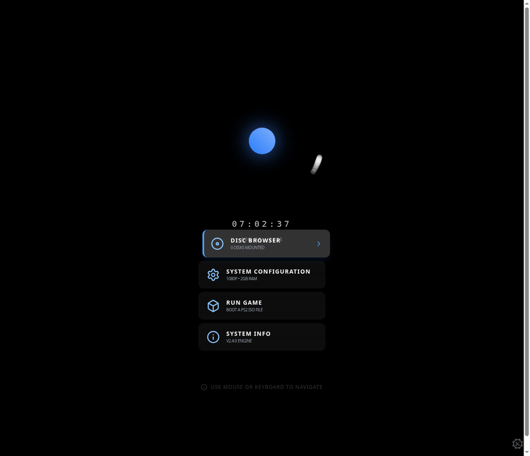
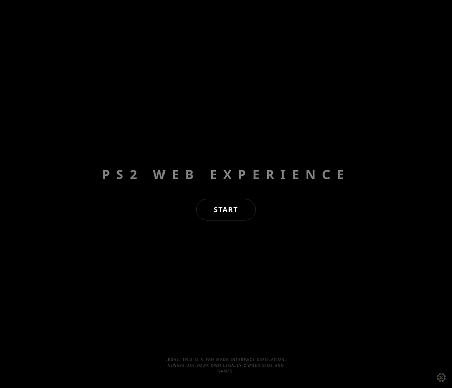
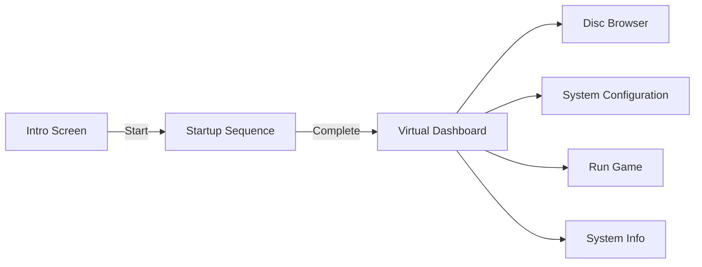

<div align="center">

# PS2 Web Experience

### A nostalgic PlayStation 2-inspired interface simulation for the modern web.

<p>
  <a href="https://ps2-webxperience.pages.dev/"><strong>Open Live Demo</strong></a>
  ·
  <a href="https://github.com/Quincunx33/PS2-WebXperience/issues">Report an Issue</a>
  ·
  <a href="https://github.com/Quincunx33/PS2-WebXperience">View Source</a>
</p>

<p>
  
  
  
  
</p>



</div>

## Overview

**PS2 Web Experience** is a fan-made browser interface simulation inspired by the atmosphere, startup sequence, typography, navigation patterns, and visual language of the PlayStation 2 era. It is designed as an interactive nostalgia piece rather than an emulator: visitors enter through a cinematic startup flow and arrive at a minimalist virtual dashboard with system-style controls.

> This project does not ship with PlayStation BIOS files or commercial games. Use only legally owned software and content.

## Live Demo

Experience the interface in your browser: **[ps2-webxperience.pages.dev](https://ps2-webxperience.pages.dev/)** [1]

## Highlights

| Experience | Description |
| --- | --- |
| **Intro screen** | A focused landing screen with a glowing title, animated start control, and a clear fan-project notice. |
| **Startup sequence** | A staged boot experience with PlayStation 2-inspired branding and memory-card initialization messaging. |
| **Virtual dashboard** | A dark, atmospheric menu with disc browser, system configuration, run game, and system information entries. |
| **Motion design** | Smooth transitions, animated highlights, scanlines, glow effects, and a retro visual rhythm powered by Motion. |
| **Audio feedback** | User-interaction-aware sound initialization and interface feedback through the project sound service. |
| **Responsive layout** | A centered experience that adapts across desktop and smaller screens while preserving the original mood. |
| **Browser-first** | Built as a lightweight web experience that can be opened directly from a modern browser. |

## Screenshots

<div align="center">
  
  
</div>

## Tech Stack

| Layer | Technologies |
| --- | --- |
| **Frontend** | React 19, TypeScript, JSX |
| **Build tooling** | Vite 6, Tailwind CSS 4, TypeScript compiler |
| **Interaction and motion** | Motion, Lucide React |
| **Audio and persistence** | Project sound service and browser storage service |
| **Deployment** | Cloudflare Pages live deployment |

## Getting Started

### Prerequisites

Install **Node.js** and npm before running the project locally.

### Installation

```bash
git clone https://github.com/Quincunx33/PS2-WebXperience.git
cd PS2-WebXperience
npm install
```

### Run the development server

```bash
npm run dev
```

Open the local URL shown by Vite in your browser. The project script is configured to serve the development experience on port `3000`.

### Build for production

```bash
npm run build
```

### Type-check the project

```bash
npm run lint
```

## Project Structure

```text
.
├── public/                 # WebAssembly runtime, service worker, and PWA assets
├── src/
│   ├── components/         # Startup, dashboard, background, clock, and controller UI
│   ├── services/           # Sound and browser-storage services
│   ├── App.tsx             # Intro → startup → dashboard application flow
│   └── index.css           # Global visual styling and retro effects
├── docs/assets/             # README screenshots
├── index.html
├── package.json
└── vite.config.ts
```

## Interaction Flow



## Legal Notice

This is an independent, fan-made interface simulation created for educational and nostalgic purposes. **PlayStation** and **PlayStation 2** are trademarks of Sony Interactive Entertainment. This repository is not affiliated with, endorsed by, or sponsored by Sony Interactive Entertainment. Do not distribute or use copyrighted BIOS files, game images, or other proprietary content without the appropriate rights.

## Contributing

Ideas, visual refinements, accessibility improvements, and bug fixes are welcome. Please open an issue before starting a substantial change so the direction can be discussed, then submit a focused pull request with a clear description of the change.

## License

No explicit open-source license has been added to this repository yet. Until a license is provided, the source remains **all rights reserved** by the repository owner. Please open an issue if you would like to discuss licensing or reuse.

## References

[1]: https://ps2-webxperience.pages.dev/ "PS2 Web Experience live demo"
[2]: https://github.com/Quincunx33/PS2-WebXperience "PS2 Web Experience source repository"

<div align="center">
  <sub>Built with curiosity, code, and a little early-2000s nostalgia.</sub>
</div>
